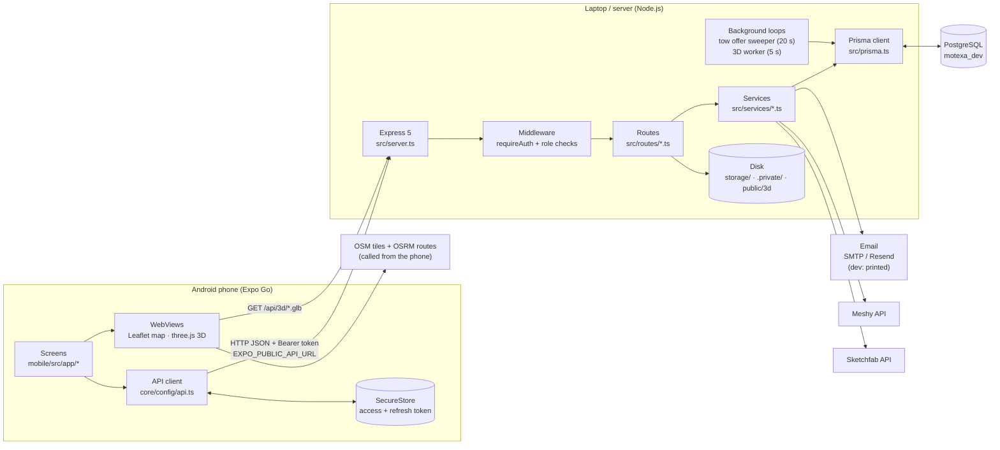

# 00 — What MOTEXA is (overview)

This guide explains the whole MOTEXA codebase for the graduation defence. It was written from the real code (backend/, mobile/,
the Prisma schema and the tests), not from plans. When something is only partly built, or not built at all, the guide says so.

Files of this guide:

| File | What it covers |
|---|---|
| 00-overview.md | this page: the idea, the roles, the stack and why, one diagram |
| 01-run-and-test.md | how to run it, the `.env` names, the tests |
| 02-backend.md | the Express API: folders, request path, auth, uploads, errors |
| 03-database.md | the Prisma models and why the important fields exist |
| 04-mobile.md | the Expo app: folders, screens per role, session, design, EN/AR, light/dark |
| 05-features.md | every feature end to end, in the order a user meets it |
| 06-security-and-privacy.md | every protection in the code, and what is still open |
| 07-defence-questions.md | 30 likely committee questions with honest answers |

---

## 1. The idea in one paragraph

MOTEXA is a car-services app for Palestine (graduation project, An-Najah National University, Computer Engineering). One app
connects car owners with three kinds of providers: **verified mechanics**, **car-parts shops** (a marketplace with cash orders) and
**tow companies** with real trucks and drivers. MOTEXA's own admins review every provider before customers can see them. A special
feature lets a customer see some shop accessories (bumpers, a rear wing, rims) **in 3D on a model of their own car**. Prices are in
Israeli shekels (shown like `₪ 120.00`), every screen exists in English and Arabic (right-to-left), and the city list is a fixed list
of 22 Palestinian cities (`backend/src/cities.ts`).

Size, to give a feel: the backend has about 16,000 lines of TypeScript (not counting the generated Prisma client), 52 database
models and 57 migrations. The mobile app has about 40,000 lines of TypeScript/TSX and about 170 route files.

What is **not** in the code:
- **AI car diagnosis**: design only (`docs/agents/AI-DIAGNOSIS-DESIGN.md`). The customer home shows a "Coming soon" row
  (`mobile/src/app/customer/(tabs)/index.tsx`). There is no AI library, key, route or table.
- **Online payment**: orders are cash only (pay at the shop or cash on delivery). The checkout shows "Card — Coming soon"
  (`mobile/src/app/customer/checkout.tsx`).
- **Push notifications**: notifications are rows in the `Notification` table that the app reads; nothing is pushed to the phone.
- **Real-time sockets**: "live" screens poll the API every few seconds (`mobile/src/core/hooks/useLoad.ts`).
- `apps/web/` holds only a built `dist/` folder and `node_modules/`, no source code. This guide does not cover it.

---

## 2. The roles

Roles are the `UserRole` enum in `backend/prisma/schema.prisma`. One account has exactly one role.

| Role | Who | How an account gets this role | Lands on (`mobile/src/core/session/landing.ts`) |
|---|---|---|---|
| `CUSTOMER` | a car owner | signs up in the app and confirms the email code (`POST /api/auth/register`, `/verify-email`) | `/customer` |
| `MECHANIC` | an approved mechanic | a customer applies ("Work with MOTEXA"); the Mechanics admin approves | `/mechanic` |
| `PARTS_PROVIDER` | a parts shop owner | a customer applies; the Parts admin approves | `/provider/parts` |
| `TOW_PROVIDER` | a tow company owner | a customer applies; the Tow admin approves | `/provider/tow` |
| `TOW_DRIVER` | a driver of a tow company | the approved company owner adds the driver (`services/tow-dispatch.ts` `addDriver`) | `/driver` |
| `ADMIN` | a department admin | invited by the super admin, then confirms an email code and sets a password | `/dept` |
| `SUPER_ADMIN` | the owner of the platform | created once by a seed script (`backend/src/seed/super-admin.ts`) | `/admin/(tabs)` |

An `ADMIN` is useless without a **permission** (table `AdminPermission`). There are three:

| Permission | Department | Reviews / supervises |
|---|---|---|
| `MANAGE_MECHANICS` | Mechanics | mechanic applications, mechanic requests |
| `MANAGE_SPARE_PARTS` | Spare parts | parts shops, products, the 3D catalog and 3D accessories |
| `MANAGE_TOWING` | Towing | tow companies, trucks, driver licences, tow jobs, problem reports |

The super admin passes every department check. The rule that **only a department's own admin can give a provider role** is
enforced in code and tested (`backend/tests/auth-security.test.mjs` scans the source for any write that sets a role).

---

## 3. The tech stack and why each part was chosen

The reasons below are the ones that match how the code actually uses each tool.

### Mobile: React Native + Expo (SDK 57)
- **One TypeScript codebase** for an Android phone (the main target) and a web preview used for automated screenshots.
- **Expo Go**: the app runs on a real Android phone by scanning a QR code, with no Android Studio build. The project rule
  (`CLAUDE.md`, `AGENTS.md`) is that every package must work inside Expo Go, so only Expo-supported modules are used:
  `expo-secure-store` (tokens), `expo-location` (GPS), `expo-image-picker` (photos), `expo-video` (the "Mo" mascot clips),
  `expo-file-system` (caching 3D model files), `react-native-webview` (maps and the 3D viewer).
- **Why a WebView for maps and 3D**: a native map or 3D module would need a custom build. Leaflet + OpenStreetMap
  (`mobile/src/features/shared/maps.tsx`) and three.js (`mobile/src/features/car3d/sceneHtml.ts`) run inside a WebView, so they
  work in Expo Go with no API key.

### Navigation: Expo Router
- **File-based routes**: every file under `mobile/src/app/` is a screen; the folder path is the URL (`app/customer/tow/[id].tsx` is
  `/customer/tow/:id`). This keeps ~170 screens organised by role without a hand-written route table.
- **Layouts** (`_layout.tsx`) wrap a whole folder. MOTEXA uses them as role gates (`RoleGate`) and to draw tab bars
  (`(tabs)` folders). Typed routes are on (`app.json` → `experiments.typedRoutes`).

### Backend: Node.js + Express 5 + TypeScript
- **Express** is small and well known: a request goes through a list of middleware functions, which is exactly how MOTEXA layers
  `requireAuth` → role check → body parser → handler.
- **Express 5** sends errors thrown inside `async` handlers to the error handler automatically. `routes/mechanics.routes.ts` relies on
  this: its `fail()` simply throws.
- **TypeScript** (strict mode, `backend/tsconfig.json`) catches wrong field names at compile time, especially with the generated
  Prisma types. `tsx watch` runs it in development without a build step.

### Database access: Prisma 7
- The schema is one readable file (`backend/prisma/schema.prisma`); Prisma **generates a typed client** from it
  (`backend/src/generated/prisma`, git-ignored, made by `npx prisma generate`).
- **Migrations** (`backend/prisma/migrations/`, 57 folders) record every schema change as SQL. The project rule is additive
  migrations only and never `migrate reset`.
- `prisma.$transaction(...)` gives real transactions; `$queryRaw` is used where SQL is needed (row locks `FOR UPDATE`, atomic stock
  updates, an `INSERT … ON CONFLICT` rate limiter). Prisma 7 talks to PostgreSQL through the `pg` driver adapter (`src/prisma.ts`).

### Database: PostgreSQL
The data is strongly relational (users → shops → products → orders → items), and the code uses PostgreSQL features on purpose:
- **transactions and row locks** for state machines and one-time codes;
- **partial unique indexes**, e.g. "one active tow request per customer and company" and "one active garage car per user";
- **CHECK constraints**, e.g. a `ProviderMedia` row belongs to exactly one owner;
- **arrays** (`String[]` for service cities, skills) and **JSON** columns (3D configs, audit details);
- **advisory locks** (`pg_advisory_xact_lock`) so only one process changes the 3D catalog at a time.

### Other important libraries
| Library | Used for | Where |
|---|---|---|
| `argon2` | password hashing (argon2id) | `routes/auth.routes.ts`, `services/password-reset-completion.service.ts` |
| `jsonwebtoken` | 15-minute access tokens (HS256) | `services/auth-session.service.ts`, `middleware/auth.middleware.ts` |
| `nodemailer` / `resend` | sending emails (SMTP first, then Resend, else printed in dev) | `services/email.service.ts` |
| `sharp` | image checks and resizing (3D photos, media) | `services/accessory3d.ts`, `services/provider-media.ts` |
| `@gltf-transform/*`, `meshoptimizer` | checking and optimising 3D `.glb` files | `services/vehicle3d-validation.ts`, `services/vehicle3d-preparation.ts` |
| three.js (CDN, in WebView) | the 3D car viewer | `mobile/src/features/car3d/sceneHtml.ts` |
| Leaflet + OpenStreetMap tiles | maps | `mobile/src/features/shared/maps.tsx` |
| OSRM public server | road route lines on maps | `mobile/src/features/shared/routing.ts` |
| Meshy API | turning photos into a 3D model (paid) | `backend/src/services/meshy-client.ts` |
| Sketchfab API | importing licensed car models | `backend/src/services/sketchfab-client.ts` |
| Playwright (Chromium) | headless runs of the real 3D viewer (auto-fit, previews, tests) and web screenshots | `backend/scripts/accessory-fit-check.mjs`, `mobile/tests/e2e/` |

---

## 4. How the app, the API and the database talk

Read it like this:
1. A screen calls `api("GET", "/catalog/parts")` (`mobile/src/core/config/api.ts`). The client adds `Authorization: Bearer <access
   token>`, refreshing the token first if it has less than a minute left.
2. Express (`backend/src/server.ts`) sends the request to the right router. `requireAuth` checks the token **and reloads the user from
   the database** (role, status, session version), then a role guard such as `requireCustomer` runs.
3. The route validates the input by hand, calls a service or Prisma directly, and writes an `AuditLog` row for every state change.
4. Prisma runs SQL on PostgreSQL. Files (photos, documents, 3D models) are on the server's disk; the database stores only their
   metadata and a random storage key.
5. The answer is JSON. The phone never reads the database or the disk directly.

Two loops run inside the backend process (started at the end of `server.ts`):
- `startOfferSweeper()` (`services/tow-offers.ts`), every 20 s: tow offers nobody answered in time are re-offered or ended.
- `startVehicle3DWorker()` (`services/vehicle3d-generation.ts`), every 5 s: one step of the 3D jobs (customer car models, Sketchfab
  imports, shop accessories).
