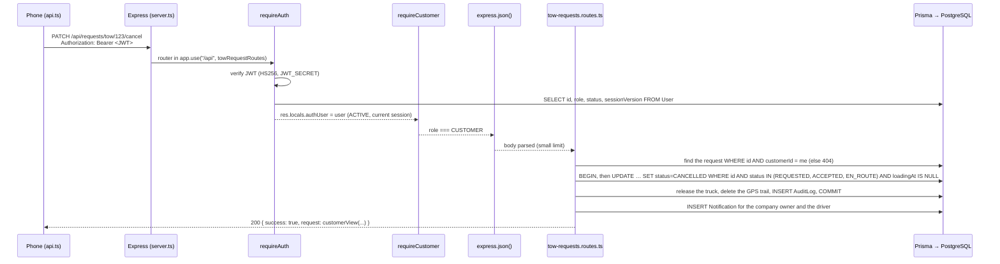

# 02 — The backend (Express API)

## 1. Folder structure

```
backend/
├─ package.json            scripts: dev, test, seed:*; dependencies
├─ tsconfig.json           strict TypeScript, ES modules (NodeNext)
├─ prisma.config.ts        tells Prisma where the schema, migrations and DATABASE_URL are
├─ prisma/
│  ├─ schema.prisma        all 52 models and enums (see 03-database.md)
│  └─ migrations/          57 SQL migrations, oldest first
├─ src/
│  ├─ server.ts            creates the Express app, mounts every router, error handler, starts the 2 background loops
│  ├─ prisma.ts            the one shared Prisma client (+ the "tests only on *_test databases" guard)
│  ├─ middleware/auth.middleware.ts   requireAuth and every role / permission guard
│  ├─ routes/              27 routers: one file per area (auth, tow, parts, catalog, mechanics, 3D …)
│  ├─ services/            the business rules shared by routes (sessions, OTP, dispatch, orders, 3D pipeline …)
│  ├─ uploads/providerFiles.ts        upload parsing (type from the bytes) and disk storage for provider files
│  ├─ seed/                dev-only data scripts
│  ├─ generated/prisma/    the generated Prisma client (git-ignored)
│  └─ cities.ts, geo.ts, catalogCategories.ts, vehicleCatalog.ts, generations.ts, mechanicSkills.ts, partAttributes.ts
│                          fixed lists shared by many routes
├─ storage/                private files on disk (provider-files/, vehicle3d/, mechanic-documents/) — never served statically
├─ .private/               more private local data (mechanic documents by default, dev tools output) — git-ignored
├─ public/3d/              optimised car models (.glb) and published accessories (accessories/acc-*.glb)
├─ public/cars/            one credited photo per car generation
├─ scripts/                developer tools and the test runner (see 01-run-and-test.md)
├─ tests/                  51 test files
└─ dist/                   an old compiled build (npm run build); not used by npm run dev
```

The layering is simple: **routes** read and check the HTTP input and shape the output; **services** hold rules used by more than one
route (or long logic); **Prisma** is called from both. There is no separate "controller" or "repository" layer.

## 2. How `server.ts` is built, and why the order matters

`backend/src/server.ts` mounts routers in a deliberate order:

1. `app.use(cors())` — the app and web preview may call from another origin.
2. Routers that carry **base64 uploads** (tow, parts, provider onboarding, provider review, 3D, orders, requests) are mounted
   **before** the global JSON parser. Each of them parses its own body *after* `requireAuth`, with its own size limit
   (`express.json({ limit: "25mb" })` for truck photos, `"7mb"` for one 3D photo, `"8kb"` for small forms). This way an anonymous
   caller can never make the server read a 25 MB body.
3. Two small regex "switches" send only matching paths to the 3D routers, so their guards do not run on other URLs.
4. `/api/3d/*` serves model files with `express.static`, but **only after** `isPublic3DAsset()` (`services/vehicle3d-public-assets.ts`)
   confirmed the file is currently published. Anything else is a 404.
5. `/api/cars/*` serves the generation photos (public, cached 30 days).
6. `app.use(express.json({ limit: "8mb" }))`, then `/api/health`, `/api/auth`, `/api/apply`, `/api/mechanics`,
   `/api/auth/password-reset`, `/api/admin-management`, `/api/admin-invitations`, `/api/auth/admin`.
7. The global error handler (see §6).
8. `app.listen(PORT)`, then `startOfferSweeper()` and `startVehicle3DWorker()`.

## 3. How one request travels (route → middleware → service → Prisma → response)

Example: a customer cancels a tow request: `PATCH /api/requests/tow/:id/cancel` with `{ "reason": "..." }`.



The pattern repeats everywhere:
1. **Authentication**: `requireAuth` (`middleware/auth.middleware.ts`).
2. **Authorization**: a role guard (`requireCustomer`, `requireTowProvider`, …) and, for providers, `requireApprovedProvider`.
3. **Input checks by hand** (no Zod): type checks, trimming, length limits (`text(v, max)` helpers), fixed lists
   (`canonicalCity`, `MECHANIC_SKILLS`, category keys), coordinates inside the map box (`readPair` in `geo.ts`).
4. **Ownership in the query itself**: `findFirst({ where: { id, customerId: me.id } })`. Another user's id simply "does not exist" (404),
   so the API does not even reveal that it exists.
5. **State changes as one conditional update**: `updateMany({ where: { id, status: "REQUESTED" }, data: {...} })` and then
   `if (count === 0) → 409`. Two people tapping at the same moment cannot both win (no "read, then write" race).
6. **AuditLog row** inside the same transaction.
7. **Shaped response**: every view is built from an explicit field list (`customerView`, `companyView`, `mechanicView`), never by
   returning a whole database row. This is where privacy rules live (see 06).

## 4. Authentication

### 4.1 Access token + refresh token (`services/auth-session.service.ts`)
- **Access token**: a JWT signed with HS256 and `JWT_SECRET` (must be ≥ 32 characters), valid **15 minutes**. Payload: `sub` = user id,
  `role`, `sessionVersion`.
- **Refresh token**: 32 random bytes (64 hex chars), valid **30 days**. The database stores only its **SHA-256** (`RefreshToken.tokenHash`),
  so a stolen database dump cannot be used to sign in.
- **Rotation** (`POST /api/auth/refresh`, `rotateSession`): each use revokes the old row and returns a new pair in the same `familyId`.
  The claim is atomic (`updateMany … where revokedAt: null`).
- **Reuse detection**: presenting an already revoked token revokes the **whole family** (a sign of theft).
- **Logout** (`POST /api/auth/logout`): revokes the family of that device.
- **Session version**: `User.sessionVersion` is copied into every token and every refresh row. A password reset or a role promotion
  increments it, so every old access token and refresh token stops working at once (`services/session-version.service.ts`).

### 4.2 `requireAuth` (`middleware/auth.middleware.ts`)
1. Reads `Authorization: Bearer …` (else 401).
2. Verifies the JWT with `algorithms: ["HS256"]` only (else 401).
3. **Reloads the user from the database**: id, role, status, sessionVersion. Not active → 403. Old session version → 401.
4. Stores the fresh user in `res.locals.authUser`.

Because of step 3, the role and status in the token are never trusted: a suspended account or a just-promoted provider is seen
correctly on the very next request.

### 4.3 Login and signup (`routes/auth.routes.ts`)
- `POST /api/auth/login`: argon2 verify. For an unknown email it verifies against a dummy hash, so the answer takes as long as a wrong
  password (no "does this email exist" timing leak). Same message for both: "Invalid email or password." A not-yet-confirmed
  customer gets `403 EMAIL_NOT_VERIFIED` and a new code.
- `POST /api/auth/register`: customers only (see 05-features.md). Always the same `202 CHECK_EMAIL` answer.
- `POST /api/auth/verify-email`: the 6-digit code **plus the password**, then the account becomes ACTIVE and is signed in.
- `GET /api/auth/me`: the signed-in user, admin permissions and Work-with-MOTEXA applications.

### 4.4 The rate limiter (`createLimiter` in `services/auth-session.service.ts`)
One fixed-window counter per key, stored in the `RateLimit` table (survives restarts, shared by every backend process). The `hit`
is a single `INSERT … ON CONFLICT DO UPDATE` statement, so it is atomic.

| Limiter | Limit |
|---|---|
| `login-email` / `login-ip` | 5 failed logins per email / 20 per IP in 15 minutes → 429 until the window ends |
| `signup-email` / `signup-ip` | 5 signups per email / 20 per IP per hour |

A wrong password on `/verify-email` counts as a failed login. Password recovery has its own **in-memory** per-IP limiter
(`createResetIpLimiter`, 20 per hour, max 10,000 IPs tracked) plus durable per-account limits in the database.
One-time codes (`services/otp.service.ts`): 6 digits from `crypto.randomInt`, stored only as an HMAC-SHA256 with `OTP_HASH_SECRET`,
**5 minutes**, **5 tries**, **60 s** between sends, **5 per hour**. Each use (signup, admin invitation, password reset) mixes a
different prefix into the HMAC, so a code made for one purpose can never be accepted for another.

### 4.5 Roles and permissions (the guards)
All in `middleware/auth.middleware.ts`, used **after** `requireAuth`:

| Guard | Lets through |
|---|---|
| `requireSuperAdmin` | `SUPER_ADMIN` |
| `requireMechanicsAdmin` | `SUPER_ADMIN`, or `ADMIN` with `MANAGE_MECHANICS` (checked in `AdminPermission`) |
| `requirePartsAdmin` | `SUPER_ADMIN`, or `ADMIN` with `MANAGE_SPARE_PARTS` |
| `requireTowAdmin` | `SUPER_ADMIN`, or `ADMIN` with `MANAGE_TOWING` |
| `requireCustomer` | `CUSTOMER` |
| `requirePartsProvider` / `requireTowProvider` | that provider role |
| `requireTowDriver` | `TOW_DRIVER`, or `TOW_PROVIDER` (an owner who drives); the `TowDriver` link is checked again in `myDriver()` |

Extra gates outside this file:
- `requireApprovedProvider` (`services/provider-onboarding.ts`): a tow company or shop can sign in and fill its application, but
  cannot act as a provider until its profile is `APPROVED`.
- `requireVerifiedMechanic` (`services/mechanic-policy.ts`) and the `publicMechanic` filter (`routes/catalog-mechanics.routes.ts`):
  only an ACTIVE mechanic with a VERIFIED profile is visible or can answer requests.
- Applicant access: a `CUSTOMER` with an application may open **only their own** application endpoints (`own()` in
  `mechanics.routes.ts`, `mine()` in `provider-onboarding.routes.ts`, `requireTowApplicant` in `tow.routes.ts`).

The mobile app hides screens per role too, but every file says so: "UX gate only; the server enforces the same rule".

## 5. Uploads and private files

### 5.1 How files arrive
Files are sent as **base64 text inside JSON** (`{ name, dataBase64 }`), not as multipart forms. This works the same in Expo Go and
on the web preview without a native upload library. Body limits are raised only on the routes that need them, after authentication.

### 5.2 Provider files (`uploads/providerFiles.ts` + `routes/files.routes.ts`)
- `parseUpload()` rejects strings over the size limit *before* decoding, decodes, then **decides the type from the first bytes**
  ("magic numbers") — JPEG, PNG or WEBP only, max 5 MB. The name and MIME type the client sends are not trusted.
- `storeFile()` writes the bytes to `backend/storage/provider-files/` under a **random UUID name**. The `ProviderFile` table keeps the
  owner, purpose (`TRUCK_PHOTO`, `DRIVER_LICENCE`, …), **visibility** (`PUBLIC` / `PRIVATE`), size, SHA-256 and the storage key.
- Files are only reachable by id:
  - `GET /api/files/public/:id` — no login, only rows with `visibility = PUBLIC` (product images, truck photos, driver photos);
    a private id answers 404.
  - `GET /api/files/private/:id` — login required; allowed for the owner, the super admin, or an admin whose permission matches the
    file's purpose (tow files → `MANAGE_TOWING`, parts files → `MANAGE_SPARE_PARTS`). Answers `Cache-Control: private, no-store`.
  - `path.basename()` is applied to the storage key, so a key can never point outside the folder.
- `hasPhoto` / `MIN_PHOTO_BYTES = 2048`: a product without a real photo (≥ 2 KB) is never shown to customers.

### 5.3 Mechanic documents (`routes/mechanics.routes.ts`)
- Identity and certificate files: JPEG, PNG **or PDF**, checked by magic bytes **and** they must match the declared MIME type, max 5 MB.
- Written to `MECHANIC_DOCUMENT_DIR` (default `.private/mechanic-documents`) with file mode `0600`, folder `0700`, flag `wx` (never
  overwrite). A replaced document's old file is deleted.
- `GET /api/mechanics/documents/:id`: the owner or a mechanics reviewer. **Every view writes `MECHANIC_DOCUMENT_VIEWED`** to the audit
  log, and an approval is refused unless the deciding admin has opened the current identity document.

### 5.4 3D files
- Private (customer car photos, generated models, shop accessory photos and candidates): `backend/storage/vehicle3d/`, names must match
  `^[uuid].(jpg|glb)$` (`services/vehicle3d-private-assets.ts`). Served only through authenticated routes with `no-store`.
- Public: `backend/public/3d/<key>.glb` and `public/3d/accessories/acc-<sha256 prefix>.glb`, served only while published.
- `services/vehicle3d-validation.ts` (`readSafeGLB`) parses every GLB with gltf-transform and checks size, structure and textures
  before it is accepted; ZIP archives from Sketchfab are read in memory with bounded limits (`services/vehicle3d-archive.ts`).

### 5.5 Provider public media (`services/provider-media.ts`)
Profile / cover / gallery photos (JPEG / PNG / WebP, decoded by `sharp`, at least 64 px, max 5 MB) and, for tow companies, MP4 videos
(checked to be a real MP4 with a video track, max 20 MB). They live in `ProviderMedia`, separate from verification documents, with
at most 60 items per owner, and are served at `/api/catalog/provider-media/:id`.

## 6. Error handling
- Each router has a small error class that carries an HTTP status: `HttpError` (tow requests, mechanic requests, onboarding),
  `DispatchError` (tow dispatch), `OrderError` (orders), `GarageError`, `MechanicError`, `Vehicle3DError` (all 3D).
  Handlers `throw` them; a `send()` / `handle()` wrapper turns them into `{ success: false, message }` with the right status.
- **Stable error codes**: `services/error-codes.ts` maps the start of common messages to a code (`ACTIVE_REQUEST_EXISTS`,
  `NOT_ENOUGH_STOCK`, …). `errorBody()` adds `errorCode`; the app shows its own English/Arabic text for it
  (`mobile/src/core/session/errorText.ts`). Tests check both sides stay in sync (`backend/tests/error-codes.test.ts`,
  `mobile/tests/error-codes-parity.test.mjs`).
- Anything unexpected is logged with `console.error` and answered as `500 "Internal server error."`. The 3D handlers log nothing but a
  fixed sentence, so storage paths and provider data never leak.
- The global handler at the end of `server.ts` turns a too-large body into 413, malformed JSON into 400 and the rest into 500.
- Express 5 forwards errors thrown in `async` handlers to these handlers automatically.

## 7. Every important file, one line each

### Core
| File | What it does / why it exists |
|---|---|
| `src/server.ts` | builds the app, mounts routers in a safe order, global error handler, starts the background loops |
| `src/prisma.ts` | one Prisma client for the whole process; refuses non-`_test` databases in tests |
| `src/middleware/auth.middleware.ts` | `requireAuth` (JWT + fresh user from DB) and every role / permission guard |
| `src/uploads/providerFiles.ts` | base64 parsing, type sniffing, 5 MB cap, random file names, `hasPhoto` rule |
| `src/cities.ts` | the 22 service cities and `canonicalCity()` (one spelling in the DB) |
| `src/geo.ts` | the accepted map box, city centres, haversine distance, `round3` (~110 m), `readPair` coordinate check |
| `src/catalogCategories.ts` | parts groups → categories → sub-categories (a product stores one leaf key) |
| `src/vehicleCatalog.ts` | the makes / models / years customers and shops choose from (no free text) |
| `src/generations.ts` | parsing `docs/3d/generations-master.tsv` (car generations like "W202") |
| `src/mechanicSkills.ts`, `src/partAttributes.ts` | fixed lists of mechanic skills, part conditions and types |

### Routes (`src/routes/`)
| File | What it serves |
|---|---|
| `auth.routes.ts` | register, verify-email, login, refresh, logout, me, admin invitation verify + activate |
| `apply.routes.ts` | `POST /api/apply/:kind` — a customer starts a mechanic / tow / parts application |
| `password-reset.routes.ts` | request a recovery code, verify it, set the new password |
| `admin.routes.ts` | super admin dashboard numbers and provider directory (`/api/admin-management`) |
| `admin-invitations.routes.ts` | super admin: invite, list, revoke admins, suspend / reactivate an admin |
| `admin-otp.routes.ts` | invitation landing page (HTML), request and verify the invitation email code |
| `mechanics.routes.ts` | mechanic application (profile, documents, submit), reviewer interview + decision, notifications |
| `catalog-mechanics.routes.ts` | customers: list / detail of public mechanics (`publicMechanic` rule) |
| `mechanic-requests.routes.ts` | customer ↔ mechanic service requests and their state machine, location privacy |
| `mechanics-admin.routes.ts` | mechanics admin: stats, list, detail (audited), cancel with reason |
| `tow.routes.ts` | tow company profile, trucks (CRUD, documents, status), tow admin review / edit / archive |
| `tow-requests.routes.ts` | customer tow requests and the company side (accept with a truck, decline, status, cancel) |
| `tow-drivers.routes.ts` | driver app (jobs, steps, location), owner's drivers + assignment + live map, tow admin jobs / licences / reports |
| `tow-job-extras.routes.ts` | job chat, 1–5 star review, "report a problem" |
| `parts.routes.ts` | shop profile and products (fitment, photo, sale, warranty), parts admin review / hide / edit |
| `parts-orders.routes.ts` | customer orders, shop order handling, delivery settings, live courier point, admin read-only |
| `part-inquiries.routes.ts` | customer questions to a shop about one product, with messages |
| `catalog.routes.ts` | customer storefront: parts search/filters, shops, vehicles, tow companies; mounts the garage router |
| `garage.routes.ts` | customer garage (up to 10 cars, one active) and the old "my car" API |
| `files.routes.ts` | public / private provider files by id |
| `provider-onboarding.routes.ts` | provider side of the application (info, documents, submit, messages) + `/api/notifications` |
| `provider-review.routes.ts` | tow / parts admins review applications (checklist enforced, flag fields, approve, reject, messages) |
| `provider-portal.routes.ts` | provider summary, public media, shop profile, the shop's 3D product list |
| `vehicle3d.routes.ts` | the runtime 3D catalog, customer car-model submissions, parts admin review of them |
| `vehicle-catalog.routes.ts` | vehicle requests (customer asks for a car), taxonomy management, Sketchfab / upload imports |
| `vehicle3d-management.routes.ts` | parts admin: list, configure, hide/show, delete published car models |
| `accessory3d.routes.ts` | shop 3D accessory requests, admin review / generation / publish, zones, part maps, auto-fits, customer view |

### Services (`src/services/`)
| File | What it does |
|---|---|
| `auth-session.service.ts` | sign access tokens, issue / rotate / revoke refresh tokens, the DB rate limiter |
| `session-version.service.ts` | compares a token's `sessionVersion` with the user's |
| `otp.service.ts` | 6-digit codes, HMAC hashing, constant-time compare, the 5-minute / 5-tries rules |
| `password-reset.service.ts` | reserve a recovery code under a row lock, send it in a background queue, in-memory IP limiter |
| `password-reset-completion.service.ts` | verify the code → one-time grant → set the password; password policy; `awaitingEmail` |
| `email.service.ts` | one `deliverEmail` (SMTP → Resend → dev print) and every email text |
| `activation-link.service.ts` | builds the deep link and the small HTML page for admin invitations |
| `applications.ts` | Work with MOTEXA: list applications, block when customer work is open, `promoteApplicant` |
| `mechanic-policy.ts` | mechanic skills, "profile complete" rule, `requireVerifiedMechanic` |
| `provider-onboarding.ts` | shared tow / parts application rules: load, shape, checklist, `notify`, `adminIds`, approved gate |
| `provider-portal.ts`, `provider-media.ts`, `public-provider-presentation.ts` | provider portal summary and public media |
| `tow-dispatch.ts` | drivers: status FREE/BUSY/OFFLINE, add / review drivers, routing a new request, assign, driver steps, GPS pings |
| `tow-offers.ts` | the 20-second sweeper: re-offer to the next nearest driver or end with TIMEOUT |
| `tow-cards.ts` | the public "driver card" (short name, rating, masked plate) and free drivers near a point |
| `truck-eligibility.ts` | "a truck with an expired document takes no new work" rule |
| `parts-orders.ts` | order placing (server prices), shop steps, stock reservation, customer cancel, courier ping |
| `fitment.ts` | "does this part fit this car?" — one rule as a Prisma filter and in memory |
| `catalog-badges.ts` | sale price rules and product badges (discount, sold out, low stock, new, used) |
| `garage.ts` | garage validation against the vehicle list and generations, one active car |
| `numbers.ts` | strict number parsing, including Arabic-Indic digits |
| `error-codes.ts` | the stable error-code table |
| `accessory3d.ts` | the whole shop-accessory 3D lifecycle (save, photos, submit, approve, generate, preview, publish, customer view) |
| `accessory-autofit.ts` | computes and stores an accessory's fit per car generation with the real viewer, approve / correct |
| `car-part-map.ts` | splits each car model into pieces, auto-labels bumpers / wheels …, admin confirms; accessory gate per car |
| `meshy-client.ts` | the Meshy API client with strict response parsing and a host allow-list for downloads |
| `sketchfab-client.ts` | Sketchfab URL parsing, license check (CC0 / CC BY / CC BY-SA only), download |
| `generation-runtime.ts` | mock vs real mode, the paid-generation switch |
| `vehicle3d-*.ts` (15 files) | customer car models: submissions, generation worker, validation, preparation, promotion into the catalog, revisions, imports, archive reader, private / public assets, management |
| `vehicle-taxonomy.ts`, `vehicle-catalog-requests.ts` | managed brands / models / generations and the customer "request my car" flow |
