# 03 — The database (PostgreSQL + Prisma)

Everything is defined in `backend/prisma/schema.prisma` (52 models). Each change to it is a migration folder in
`backend/prisma/migrations/` (57 so far). Some rules cannot be written in the Prisma language, so they were added as plain SQL inside
migrations (partial unique indexes and CHECK constraints, listed in §4).

Conventions used everywhere:
- Primary keys are UUID strings (`@id @default(uuid())`).
- `createdAt` / `updatedAt` on most tables; each status change also has its own time column (`acceptedAt`, `completedAt`, …).
- Money is `Decimal(12, 2)` (never a float), shown as ILS.
- "Normalized" columns (`makeNormalized`, `partNumberNormalized`) hold a lower-case, trimmed copy used for matching and search.
- Most child rows use `onDelete: Cascade`; history rows that must outlive their parent use `SetNull` and copy the important text.

## 1. The core tables (ER diagram)

```mermaid
erDiagram
  User ||--o{ AdminPermission : "has (admins)"
  User ||--o{ RefreshToken : "signs in with"
  User ||--o{ EmailVerificationOtp : "confirms email with"
  User ||--o{ Notification : receives
  User ||--o| MechanicProfile : "applies as mechanic"
  User ||--o| TowCompanyProfile : "owns (tow)"
  User ||--o| PartsShopProfile : "owns (shop)"
  User ||--o| TowDriver : "is a driver"
  User ||--o{ CustomerGarageCar : "keeps cars"

  MechanicProfile ||--o{ MechanicDocument : "private docs"
  User ||--o{ MechanicRequest : "asks (customer)"
  User ||--o{ MechanicRequest : "answers (mechanic)"

  TowCompanyProfile ||--o{ Truck : has
  TowCompanyProfile ||--o{ TowDriver : employs
  Truck |o--o{ TowDriver : "driven by"
  User ||--o{ TowRequest : "asks (customer)"
  TowCompanyProfile ||--o{ TowRequest : receives
  TowDriver |o--o{ TowRequest : "does the job"
  Truck |o--o{ TowRequest : "assigned truck"
  TowRequest ||--o| TowReview : "rated once"
  TowRequest ||--o{ TowRequestMessage : chat
  TowRequest ||--o{ TowJobTrail : "GPS points (while active)"
  TowRequest ||--o{ TowReport : "problem reports"

  PartsShopProfile ||--o{ PartsProduct : sells
  PartsProduct ||--o{ PartsFitment : "fits cars"
  User ||--o{ PartsOrder : places
  PartsShopProfile ||--o{ PartsOrder : receives
  PartsOrder ||--|{ PartsOrderItem : lines
  PartsProduct |o--o{ PartsOrderItem : "copied into"
  PartsOrder ||--o{ PartsOrderMessage : chat
  User ||--o{ PartInquiry : asks
  PartsShopProfile ||--o{ PartInquiry : answers

  Vehicle ||--o{ VehicleGeneration : "has generations"
  VehicleGeneration |o--o{ CustomerGarageCar : "is the car"
  PartsProduct ||--o{ ProductAccessory3D : "3D part(s)"
  ProductAccessory3D ||--o{ ProductAccessory3DFit : "fits generation"
  VehicleGeneration ||--o{ ProductAccessory3DFit : ""
  ProductAccessory3D ||--o{ AccessoryAutoFit : "stored fit per car"

  User ||--o{ ProviderFile : uploads
  Truck ||--o{ ProviderFile : "photo + documents"
  PartsProduct ||--o{ ProviderFile : "product image"
  TowCompanyProfile ||--o{ ProviderMessage : "review thread"
  PartsShopProfile ||--o{ ProviderMessage : "review thread"
```

`AuditLog`, `RateLimit` and `CarPartMap` are deliberately **not** linked by foreign keys (explained below).

## 2. The models by area

### 2.1 Accounts and security
| Model | What it is | Why the important fields exist |
|---|---|---|
| `User` | every account | `email @unique` (one account per email, always stored lower-case). `passwordHash` is argon2. `role` + `status` (`ACTIVE`, `PENDING`, `SUSPENDED`, `REJECTED`): only ACTIVE can use the API. `sessionVersion`: incremented to end every session at once (password reset, role promotion). `emailVerifiedAt`: set when the signup code is confirmed. `phone` is optional (customer signup). Index `(role, status)` for admin counts. |
| `AdminPermission` | one department permission of an admin | `@@unique([adminId, permission])`: no duplicates; the guards look it up by this key. |
| `AdminInvitation` | an invitation sent by the super admin | `tokenHash @unique`: only the SHA-256 of the link token is stored. `status` PENDING / ACCEPTED / REVOKED, `expiresAt` (24 h). `acceptedById @unique`: one invitation creates at most one account. |
| `AdminInvitationOtp` | the email code of an invitation | `codeHash` (HMAC), `attempts` / `maxAttempts` (5), `verifiedAt` then `consumedAt`: a code is verified once and used once. |
| `RefreshToken` | one long sign-in on one device | `tokenHash @unique` (SHA-256 only), `familyId` (all rotations of one sign-in; revoked together on reuse), `sessionVersion` (old after a password change), `expiresAt` (30 days), `revokedAt`. |
| `EmailVerificationOtp` | the signup email code | same shape as the admin code; only the newest code of a user counts. |
| `PasswordResetRequest` | a recovery code | `codeHash`, `sentAt` (a code that was never delivered cannot be used), `resetTokenHash @unique` + `resetExpiresAt` (the 10-minute grant after the code is correct), `consumedAt`. |
| `RateLimit` | login / signup counters | `key` is the primary key (`login-email:<email>`), `windowStart` + `count`: a fixed window. No foreign key: it is a counter, not data. |
| `AuditLog` | the history of every important action | `actorId` (null = MOTEXA itself, e.g. the offer sweeper), `action` (e.g. `TOW_REQUEST_ACCEPTED`), `targetId`, `details` JSON. **No foreign keys on purpose**: the log must survive when a user or a row is deleted. The project rule is append-only (never delete audit rows). |
| `Notification` | an in-app message | `title` and `body` hold both languages as `"English||Arabic"` (`notify()` in `services/provider-onboarding.ts`); `readAt`. |

### 2.2 Mechanics
| Model | Why the important fields exist |
|---|---|
| `MechanicProfile` | `userId @unique` (one application per account). `verificationStatus` (`DRAFT` → `PENDING` → `VERIFIED` / `NEEDS_COMPLETION` / `REJECTED` / `SUSPENDED`). `specializations String[]` (from the fixed skill list). `offersWorkshop` / `offersOnSite` / `offersOnline` + `workshopName/Address`, `coverageAreas`. `interviewResult/Notes`: approval needs a passed interview. `submissionVersion`: the admin's decision must send the same number, so a reviewer never approves an application that changed after they opened it. |
| `MechanicDocument` | `@@unique([profileId, kind])`: one IDENTITY and one CERTIFICATE per profile; `storageKey` points to the private file. |
| `MechanicRequest` | a customer asking one mechanic for help. `mechanicUserId` is the mechanic's **User** id (the public id in the catalog). `status` REQUESTED → ACCEPTED → IN_PROGRESS → COMPLETED, or DECLINED / CANCELLED. `locationText` + `locationLat/Lng` (rounded to 6 decimals) and `contactPhone` are shown to the mechanic only during the active job. `cancelReason` / `cancelledBy` (CUSTOMER or ADMIN). `preferredTime` is free text (no date picker without a new native package). |

Legacy tables with **no code using them any more**: `MechanicApplication`, `MechanicSkillApplication`,
`MechanicApplicationDocument`, `MechanicEmailCheck` (an earlier design of the mechanic application). `MechanicProfile` also still has
old columns (`nationalId`, `nationalIdDocumentUrl`, `licenseDocumentUrl`, `certificateUrl`) that the API strips from every answer.
They stay because migrations are additive only.

### 2.3 Tow
| Model | Why the important fields exist |
|---|---|
| `TowCompanyProfile` | `userId @unique` (one company per account). `verificationStatus` (`DRAFT`, `PENDING` = submitted, `NEEDS_CHANGES`, `APPROVED`, `REJECTED`). `baseLat/Lng` exact (customers get it rounded to 3 decimals ≈ 110 m). `serviceCities String[]`. `flaggedFields`: what the reviewer asked to fix. `submissionVersion`. |
| `Truck` | `plateNumber @unique` (and checked case-insensitively in code). `verificationStatus` (admin review) and `operationalStatus` (`AVAILABLE`, `BUSY`, `OUT_OF_SERVICE`) are separate: an approved truck can still be busy. `archivedAt/By/Reason`: an admin takes a truck out of service **without deleting** it or its documents. `baseLat/Lng`: where the truck waits. |
| `TowDriver` | `userId @unique` (a login is a driver of one company). `truckId` with `onDelete: SetNull`. `approval` (licence review: PENDING / APPROVED / REJECTED / SUSPENDED). `offline` (the driver's switch). `lastLat/Lng/At`: last GPS point, only during an active job, cleared when it ends. |
| `TowRequest` | `customerId`, `companyId`, `driverId`, `requestedDriverId`. `choiceMode` NEAREST / COMPANY / DRIVER. `status` REQUESTED → ACCEPTED → EN_ROUTE → IN_PROGRESS → COMPLETED (or DECLINED / CANCELLED); `arrivedAt`, `loadingAt`, `deliveredAt` are extra stages inside EN_ROUTE / IN_PROGRESS. `assignedTruckType/Make/Model/Year` are **copied at acceptance (no plate)** so history stays readable if the truck is deleted. `offerExpiresAt` + `triedDriverIds`: offer timeouts and re-offers. `distanceMeters`: total driven, kept after the exact trail is deleted. `contactPhone`: typed by the customer, seen only by the company and its driver. `cancelledBy` CUSTOMER / COMPANY / SYSTEM (timeout) / ADMIN. |
| `TowReview` | `requestId @unique`: one rating per job; `stars` 1–5 (checked in code); counts for the driver and the company. |
| `TowRequestMessage` | chat of one job (customer ↔ driver); open only while the job is active. |
| `TowJobTrail` | the driver's recent GPS points of one job (max 300 kept); **deleted when the job ends**. |
| `TowReport` | "report a problem" from the customer; `closedAt` set by a tow admin. |

### 2.4 Parts shops, products, orders
| Model | Why the important fields exist |
|---|---|
| `PartsShopProfile` | like the tow profile (`verificationStatus`, `flaggedFields`, `submissionVersion`, location). `categories` / `brands` the shop declares. `deliveryEnabled`, `deliveryFee` (null = "agreed with the shop"), `deliveryAreaNote`. `accessory3dMonthlyCredits` (default 5): how many paid 3D generations a shop may use per month. |
| `PartsProduct` | `price Decimal(12,2)`, `stock`, **`reservedStock`** (units held by accepted orders; customers can buy `stock − reservedStock`). `category` = one leaf key from `catalogCategories.ts`. `condition` NEW / USED / REFURBISHED, `partType` OEM / AFTERMARKET / null. `partNumberNormalized` for search. `compareAtPrice` + `saleStartsAt/EndsAt`: a "was" price shown only while the sale window is open and it is higher. `isHidden` + `hiddenReason/By/At`: admin moderation (only admins write these). `isUniversal`: fits every car. `legacyCategory`: kept, read by nothing. |
| `PartsFitment` | which cars a product fits: `make`, `model` (exact strings from the vehicle list), normalized copies, `yearFrom/yearTo`, optional `trim`, optional `generationId` ("Fits W202" → the generation's years). |
| `PartsOrder` | one customer, one shop. `fulfilment` PICKUP / DELIVERY, `payment` CASH_ON_DELIVERY / PAY_AT_SHOP. `subtotal`, `deliveryFee`, `total` are **computed by the server** when the order is placed and then frozen. `stockReserved` flag. `courierLat/Lng/At`: the owner's live point while out for delivery. `customerReadAt` / `shopReadAt`: unread chat badges. A time column per status. |
| `PartsOrderItem` | `productId` with `SetNull`; `name`, `partNumber`, `unitPrice` are **copied**, so an order stays correct if the product changes or is deleted. |
| `PartsOrderMessage` | order chat; `senderId` null = a status line written by MOTEXA. |
| `PartInquiry` + `PartInquiryMessage` | a question about one product; product name and part number copied (product `SetNull`). |

### 2.5 Provider files and review threads
| Model | Why the important fields exist |
|---|---|
| `ProviderFile` | every uploaded provider file. `purpose` (TRUCK_PHOTO, TRUCK_REGISTRATION, DRIVER_LICENCE, PRODUCT_IMAGE …), `visibility` PUBLIC / PRIVATE, `storageKey @unique` (random name on disk), `sha256`, `expiresAt` (truck documents). Exactly one owner link (`truckId`, `productId`, `towCompanyId`, `partsShopId`, `towDriverId`) — enforced by the application. `@@unique([truckId, purpose])` and `@@unique([productId, purpose])`: one photo / one registration per truck, one image per product. `docKind`, `reviewStatus`, `reviewReason`: how the reviewer judged each document. |
| `ProviderMedia` | public presentation media (profile, cover, gallery, video), separate from verification documents. A SQL CHECK forces exactly one owner. |
| `ProviderMessage` | the thread between an applicant business and its department admins; `authorRole` PROVIDER / ADMIN / SYSTEM, read times on both sides. |

### 2.6 Cars and 3D
| Model | Why the important fields exist |
|---|---|
| `Vehicle` | the vehicle list (make, model, Arabic names, years, `bodyType`). `@@unique([makeNormalized, modelNormalized])`. Customers and shops can only pick from it, so a customer's car and a shop's fitment row always compare equal. `brandId` → `VehicleBrand` for the managed catalog. |
| `VehicleGeneration` | e.g. "C-Class W202", 1993–2000. `@@unique([vehicleId, code])`. `photoUrl` + credit + license (Wikimedia photo). `model3dKey` + `isPublished`: which 3D model file is the current one (null = "coming soon"). `isActive`. |
| `CustomerGarageCar` | up to 10 saved cars per customer (`MAX_GARAGE_CARS` in `services/garage.ts`). `isActive`: the active car powers "fits my car". **At most one active per user** (partial unique index). `generationId` with `Restrict`. `nickname VarChar(40)`. |
| `CustomerCar` | legacy single-car table, kept and not synchronised with the garage. |
| `Vehicle3DSubmission` | a customer's request to build a 3D model of their car from 4 photos (front, rear, left, right). Status DRAFT → PROCESSING → READY → SUBMITTED → APPROVED / REJECTED / FAILED, plus the provider job fields (`providerTaskId`, `providerState`, `leaseToken/Until`, `nextPollAt`) for the background worker. `catalogConsentAt/Version`: the customer's permission to publish it for everyone. |
| `VehicleBrand`, `VehicleCatalogRequest`, `Vehicle3DImport`, `Vehicle3DRevision` | the managed catalog: brands with aliases, customer "request my car", Sketchfab / file imports by the Parts admin (`sourceUid @unique` prevents importing the same model twice), and the registry of published model files (`sha256`, `viewerConfig`). |
| `ProductAccessory3D` | the 3D version of one shop product. `@@unique([productId, kitPart])`: one MAIN part, or a body kit's FRONT + REAR bumpers. `accessoryType` (FRONT_BUMPER, WING, RIMS, …). Real sizes (`widthMm`, …, `rimInches`) so the part is scaled correctly. Status DRAFT → PENDING_REVIEW → APPROVED_FOR_GENERATION → GENERATING → READY_FOR_FINAL_REVIEW → PUBLISHED / REJECTED. `creditsUsed`. `publishedFile @unique` (content-addressed file name). `visualVerifiedAt`: the admin confirmed the six-view preview. `deactivatedAt`: unpublished. |
| `ProductAccessory3DFit` | which generations the accessory is made for (PK `accessoryId + generationId`). |
| `ProductAccessory3DPhoto` | `kind` PART (2–4 photos of the loose part, sent to Meshy), INSTALLED (1–24 photos on a car; customers see them once approved) or SHOP_MODEL (a 3D file the shop uploaded). |
| `AccessoryAutoFit` | the stored fit of one accessory on one generation (PK `accessoryId + generationId`). `carRevision`, `partRevision`, `fitVersion`: the fit is computed **once** and stays valid while the car file, the part file and the viewer's fit rules are unchanged. `adj`: the Parts admin's correction. `approvedAt`. |
| `CarPartMap` | per car model file (`model3dKey` PK): the model split into pieces, an automatic labelling (`proposal`) and the admin-confirmed `map`. `modelSha256`: the app gets the map only if it was made for the exact same file. |
| `AccessoryFitZone` | an admin-tuned fitting box per car model and accessory type. |
| `AccessoryFitAdjust` | a customer's own hand-fit of a product. The table exists but the API now refuses writes (`FIT_ADMIN_ONLY`): only the Parts admin changes fits. |

## 3. Status enums at a glance
| Enum | Values |
|---|---|
| `AccountStatus` | ACTIVE, PENDING, SUSPENDED, REJECTED |
| `MechanicVerificationStatus` | DRAFT, PENDING, NEEDS_COMPLETION, VERIFIED, REJECTED, SUSPENDED |
| `ProviderVerificationStatus` | DRAFT, PENDING (submitted), NEEDS_CHANGES, APPROVED, REJECTED |
| `TowRequestStatus` | REQUESTED, ACCEPTED, DECLINED, EN_ROUTE, IN_PROGRESS, COMPLETED, CANCELLED |
| `MechanicRequestStatus` | REQUESTED, ACCEPTED, IN_PROGRESS, COMPLETED, DECLINED, CANCELLED |
| `PartsOrderStatus` | PLACED, ACCEPTED, PREPARING, READY_FOR_PICKUP, OUT_FOR_DELIVERY, PICKED_UP, DELIVERED, CANCELLED, REJECTED |
| `Accessory3DStatus` | DRAFT, PENDING_REVIEW, APPROVED_FOR_GENERATION, GENERATING, READY_FOR_FINAL_REVIEW, PUBLISHED, REJECTED |

## 4. Constraints written in SQL migrations
| Migration | Rule | Why |
|---|---|---|
| `20261113090000_tow_one_active_request` | unique `(customerId, companyId)` **where status is REQUESTED / ACCEPTED / EN_ROUTE / IN_PROGRESS** | a double tap or a second phone cannot create two active tows with the same company; the code turns the error into a friendly 409 |
| `20261103180000_customer_garage` | unique `(userId)` **where isActive = true** | exactly one active garage car |
| `20261104190000_vehicle_3d_submissions` | unique `(garageCarId)` where the submission is still open; CHECK `lengthM BETWEEN 2.5 AND 8`, `year BETWEEN 1900 AND 2100` | one open 3D request per car; sane sizes |
| `20261104210000_vehicle3d_provider_lifecycle` | CHECK `providerProgress` 0–100 | provider data can't be stored out of range |
| `20261105010000_managed_vehicle_catalog` | CHECK on `reviewState` and import `status` values | these columns are text, so SQL limits their values |
| `20261107090000_accessory_kit_part` | CHECK: FRONT only with FRONT_BUMPER, REAR only with REAR_BUMPER | a body kit's parts are always bumpers |
| `20261108120000_provider_portal_media` | CHECK exactly one owner; slot in PROFILE / COVER / GALLERY / VIDEO | media always belongs to one business |
| `20261117090000_accessory_shop_model_file` | CHECK photo kind in PART / INSTALLED / SHOP_MODEL | |

## 5. Why some design decisions
- **Copy instead of link** for history (order lines, inquiry product name, truck snapshot on a tow): the past must not change when a
  product or truck is edited or deleted.
- **State in one column + one time column per step**: a timeline can be drawn from real timestamps (no fake ETAs), and a conditional
  `updateMany` on the status column is enough to make every transition safe under concurrency.
- **Stock reservation** (`reservedStock`) instead of subtracting at order time: an order only takes stock when the shop accepts it,
  and a cancel or reject releases exactly what was held. The SQL is conditional (`WHERE stock - reservedStock >= qty`), so stock can
  never go below zero (`services/parts-orders.ts`).
- **Hashes, not secrets**: refresh tokens, invitation tokens, recovery grants are stored as SHA-256; codes as HMAC.
- **Files on disk, metadata in the database**: the database is the only way to find a file, and it decides who may read it.
